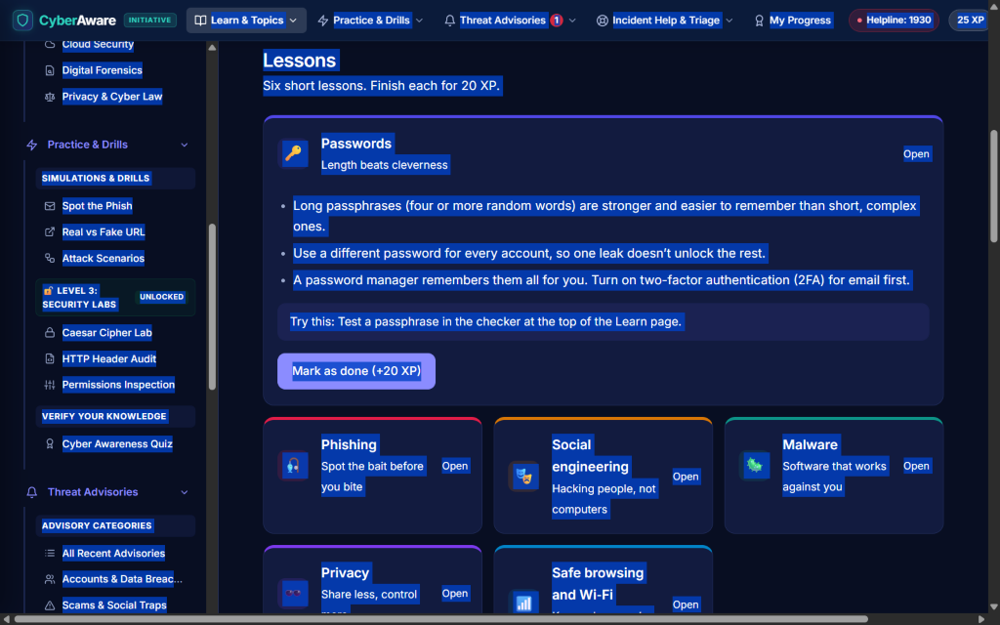
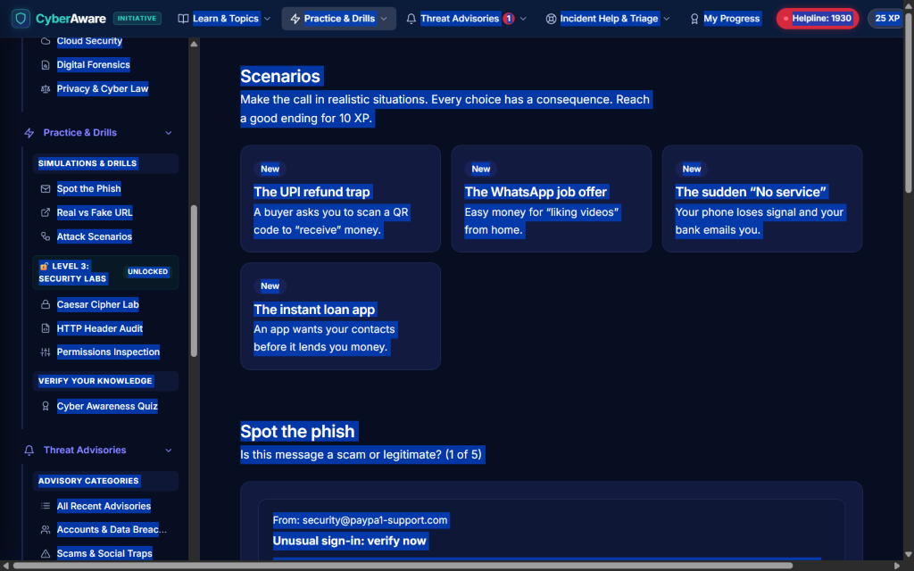
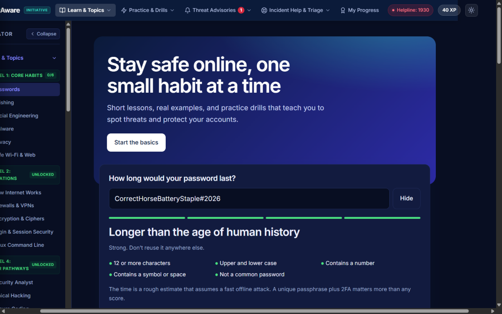
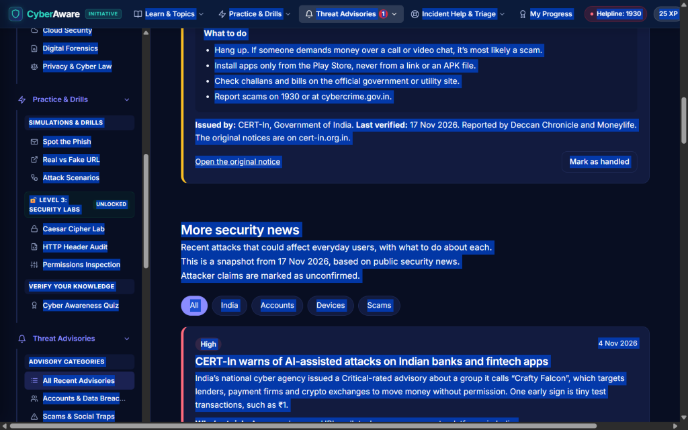
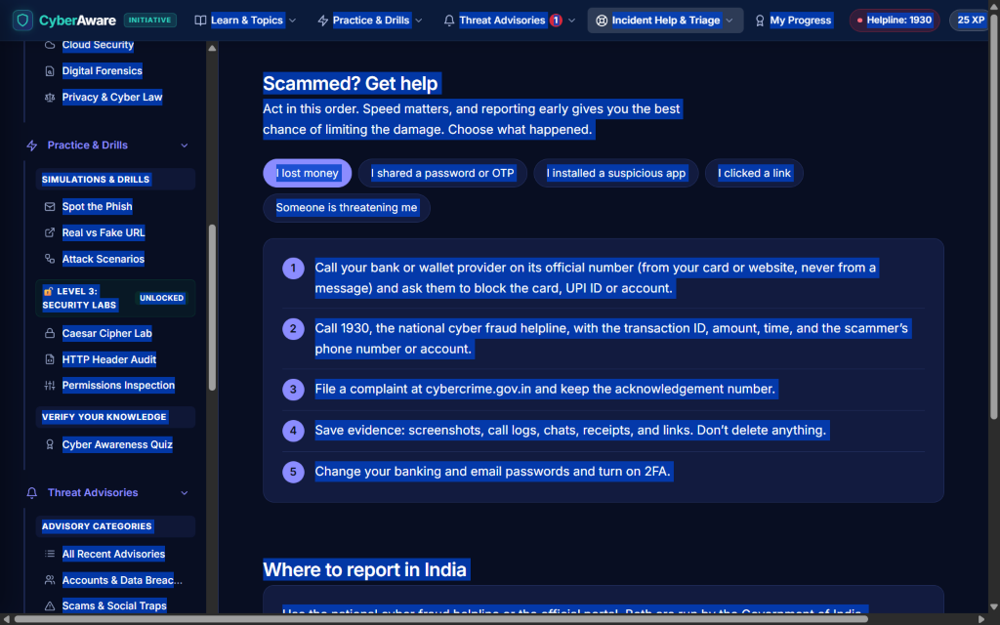
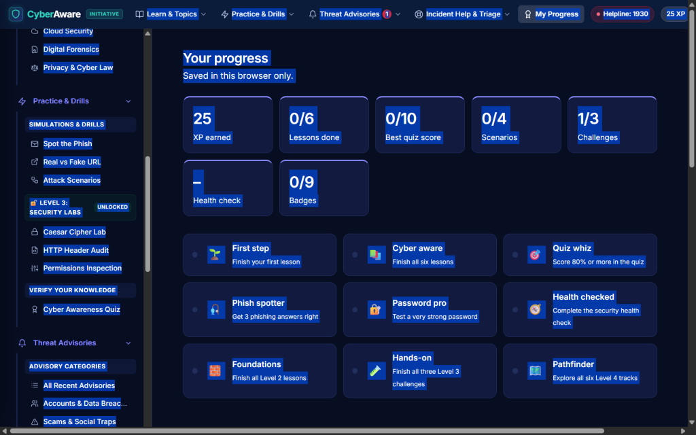
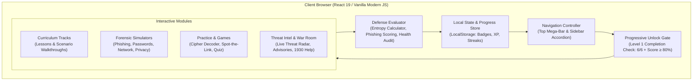

# CyberAware: Interactive Cybersecurity Education & Awareness Platform

**CyberAware** is an accessible, gamified cybersecurity education and threat simulation platform designed specifically for **students and digital beginners**. Instead of burying learners under dense academic jargon or abstract theory, CyberAware delivers practical, bite-sized learning tracks, interactive forensic labs, and real-world attack simulations that empower students to identify digital threats, secure personal data, and protect themselves online.

Learners explore **progressive learning tracks**, hands-on **simulation labs** (phishing inbox forensic analysis, password entropy and brute-force cracking calculator, privacy EXIF inspection, public Wi-Fi defense), interactive **mini-games** (Caesar cipher decoder, spot-the-link challenges), **live threat advisories**, and an **Emergency Fraud Helpline (1930) triage playbook**.

> Problem type: **Community / SDG**: built for
> [UN Sustainable Development Goal 4: Quality Education](https://sdgs.un.org/goals/goal4)
> (target 4.4: digital literacy and practical technical skills for youth) and
> [SDG 9: Industry, Innovation, and Secure Infrastructure](https://sdgs.un.org/goals/goal9).

| Home & Onboarding | Interactive Phishing Lab |
|---|---|
|  |  |
| **Password Strength & Crack Lab** | **Live Threat Radar & Alerts** |
|  |  |
| **Emergency Help & Triage (1930)** | **Student Progress & Certification** |
|  |  |

---

## 1. The problem

Many students and beginners have limited knowledge of cybersecurity and safe digital practices. Existing cybersecurity learning resources are often complex, highly technical, or focused mainly on theory, making them difficult for beginners to understand and apply. 

This creates a critical **education and awareness gap**:
- Students lack the practical, defensive skills required to identify everyday cyber threats such as phishing emails, social engineering, insecure Wi-Fi eavesdropping, and credential theft.
- When an account compromise or financial scam occurs, young learners often panic and have no clear understanding of the immediate triage steps or official reporting channels (such as national cybercrime portals or emergency helplines).
- Traditional classroom curricula offer minimal hands-on practice, leaving students vulnerable in an increasingly digital academic and personal environment.

---

## 2. Objectives

1. **Increase cybersecurity awareness** among students, school learners, and digital beginners.
2. **Make cybersecurity concepts intuitive and engaging** using visual explanations, real-world scenario breakdowns, and interactive simulations.
3. **Provide actionable, practical knowledge** about common digital threats (phishing, social engineering, password attacks, malware, insecure networks).
4. **Cultivate hands-on defensive security habits** (multi-factor authentication, entropy-driven passwords, digital footprint auditing, secure browsing).
5. **Empower prompt crisis response** by guiding users through step-by-step incident containment and official reporting mechanisms (e.g., National Cyber Crime Reporting Portal / 1930 Helpline).
6. **Promote responsible and ethical use** of internet technologies.

---

## 3. Features

### Core Modules & Activities

CyberAware organizes learning into five intuitive hubs: foundational tracks, interactive forensic labs, gamified drills, real-time threat telemetry, and career resources.

| Activity / Module | What you do | What CyberAware checks & teaches |
|---|---|---|
| **Level 1: Foundations** | Complete 6 essential starter lessons covering passwords, phishing basics, safe downloads, and privacy | Core digital hygiene; requires 6/6 lessons and quiz mastery (≥80%) to unlock subsequent levels |
| **Phishing Simulator** | Inspect simulated realistic emails (fake bank alerts, urgent scholarship requests, package tracking scams) | Header analysis, sender spoofing detection, suspicious domain flags, and malicious link previewing |
| **Password & Breach Lab** | Type passwords in real-time to observe dynamic entropy calculations and dictionary checks | Bit strength, offline hash brute-force time estimates (RTX 4090 GPU benchmarks), and common leak patterns |
| **Privacy Auditor** | Audit image uploads and personal accounts for sensitive digital footprints | EXIF location metadata extraction, social media oversharing analysis, and data broker exposure risks |
| **Malware & Virus Lab** | Examine sandbox simulations of ransomware behavior, trojan loaders, and spyware | Process isolation, file extension masquerading (`.pdf.exe`), and backup containment strategies |
| **Wi-Fi & Network Defense** | Test different Wi-Fi connection types (open public networks vs. WPA3 secured routers) | Man-in-the-Middle (MITM) attacks, SSL stripping, DNS spoofing, and VPN usage guidelines |
| **Practice & Mini-Games** | Play interactive challenges including Caesar cipher decoders, spot-the-scam links, and trivia | Active recall, pattern recognition, and practical defensive reflexes in a risk-free game format |
| **Incident War Room** | Walk through step-by-step containment playbooks during a simulated account takeover | Quarantining affected devices, invalidating active sessions, rotating recovery tokens, and evidence logging |
| **Emergency Help (1930)** | Access an emergency action checklist and official cybercrime reporting guidance | Rapid triage for financial fraud, Golden Hour banking freeze instructions, and official portal links |
| **Certification & Quiz** | Complete randomized assessments across all learning tracks | Demonstrable knowledge verification; generates a verifiable completion badge and certificate |

---

### Platform Highlights

| Feature | What it does |
|---|---|
| **Progressive Level Unlocking** | Prevents beginner cognitive overload: Advanced Drills (Level 2), Interactive Labs (Level 3), and Career Pathways (Level 4) unlock only after mastering Level 1 foundations |
| **Instant Interactive Feedback** | Every lab action provides immediate color-coded indicators, explanation panels, and remediation tips |
| **Live Telemetry Threat Map** | Visual radar displaying simulated real-time cyber attacks, attack vectors (DDoS, brute-force, ransomware), and global origins |
| **CERT-In & CISA Advisories** | Curates latest real-world security vulnerabilities and vendor patches translated into plain, beginner-friendly English |
| **Security Health Check** | A 10-point audit tool that evaluates the user's personal digital hygiene and generates a prioritized action plan |
| **Career Roadmaps** | Detailed pathways for students exploring cybersecurity careers (SOC Analyst, Penetration Tester, Incident Responder, Cloud Security) |
| **Ask CyberBuddy (Glossary)** | Searchable, jargon-free dictionary covering common threat taxonomy, acronyms, and offensive/defensive terms |
| **Local Storage Persistence** | Progress, quiz scores, unlock states, and earned badges persist locally in the user's browser without requiring complex account setup |
| **Zero-Friction Dual Stack** | Works both as a standalone single-file web application (`index.html`) or as a modular **React 19 + Vite + Tailwind CSS** application |
| **Accessible & Responsive** | Fully optimized for mobile screens, tablets, and desktop displays with WCAG AA compliant contrast and dark-mode styling |

---

## 4. How it works (architecture)



### Architectural Highlights
- **Client-Side Simulation Engine**: Labs execute safely in the client browser. No actual malicious code or live exploits are ever executed; attacks are simulated using realistic mock data, real-time regex parsing, and cryptographic math.
- **Dynamic Level Gating**: Navigation routes enforce prerequisite checks (`l2ok()`). Level 1 (Foundations) is open by default. Levels 2–4 present guided unlock criteria until the user completes the foundational lessons and quiz.
- **Password Entropy Evaluator**: Computes character space diversity (\(N^L\)), Shannon entropy, dictionary rule violations, and estimates cracking time across multiple hardware profiles (single CPU vs. multi-GPU rigs).
- **Incident Response State Machine**: Guides the user through a decision-tree wizard during simulated breaches, evaluating containment choices and presenting best-practice mitigation steps.

---

## 5. How the learning & progression system works

CyberAware uses a three-tier scoring and mastery model:

### 1. Level Gating Rules
- **Level 1 (Foundations)**: Unlocked by default. Covers 6 core lessons: Password Defense, Phishing Basics, Safe Downloads, Privacy & Social Footprints, Public Wi-Fi Dangers, and Two-Factor Authentication.
- **Level 2 (Threat Recognition & Defensive Drills)**: Unlocks when:
  $$\text{Completed Lessons} = 6/6 \quad \text{AND} \quad \text{Level 1 Quiz Score} \ge 80\%$$
- **Level 3 (Hands-on Forensic Labs)**: Unlocked after achieving Level 2 mastery or demonstrating foundational lab competency.
- **Level 4 (Career Pathways & Capstone Certification)**: Unlocked after finishing multi-module challenges.
*(A quick **Demo Unlock** button is included for instructors and evaluators to preview all levels immediately).*

### 2. Scoring & Metrics
- **Phishing Detection Accuracy**: Evaluates identification of suspicious sender domains, urgency cues, generic greetings, and deceptive attachments.
- **Password Resilience Score**: Rated from 0 to 100 based on length (12+ chars), character set variety (uppercase, lowercase, numbers, symbols), and absence of common dictionary words.
- **Security Health Index**: Assesses daily digital habits across 10 security vectors (MFA, password managers, backup frequency, software patching, privacy settings).

---

## 6. Run it on Windows

### Prerequisites
- **Node.js** (v18 or higher recommended)
- **npm** (included with Node.js)
- **Modern Web Browser** (Chrome, Edge, Firefox, or Brave)

---

### Option A: Run the React + Vite Application

1. Open PowerShell or Terminal in the project directory:
   ```powershell
   cd "c:\Users\subham(cerebus)\OneDrive\Desktop\cybersecurity awareness"
   ```

2. Install dependencies:
   ```powershell
   npm.cmd install
   ```

3. Launch the development server:
   ```powershell
   npm.cmd run dev
   ```

4. Open your browser and navigate to:
   ```
   http://localhost:5173
   ```

5. Build for production:
   ```powershell
   npm.cmd run build
   ```

---

### Option B: Standalone Zero-Dependency Run

The repository also includes an optimized, self-contained standalone version in `index.html`:
- Simply double-click `index.html` or open it in any web browser.
- All styles, icons, interactive labs, and level progression work completely offline with no build step required.

---

## 7. Project structure

```
cybersecurity-awareness/
├── public/
│   ├── screenshots/              # UI previews & module illustrations
│   └── favicon.svg               # Application icon
├── src/
│   ├── components/               # React UI components
│   │   ├── Navbar.jsx            # Header navigation & level status
│   │   ├── Sidebar.jsx           # Categorized sidebar navigation
│   │   ├── HomeWelcome.jsx       # Student onboarding & quick-start hub
│   │   ├── Overview.jsx          # Personal security metrics & dashboard
│   │   ├── PhishingSimulator.jsx # Email forensic inspection lab
│   │   ├── PasswordLab.jsx       # Password entropy & crack time simulator
│   │   ├── PrivacyAuditor.jsx    # EXIF metadata & digital footprint inspector
│   │   ├── MalwareLab.jsx        # Sandbox malware & ransomware visualizer
│   │   ├── NetworkSafety.jsx     # Wi-Fi security & MITM defense module
│   │   ├── LessonsHub.jsx        # Structured modular curriculum tracks
│   │   ├── PracticeGames.jsx     # Cipher decoders & interactive games
│   │   ├── SecurityHealthCheck.jsx # 10-point personal security audit
│   │   ├── SecurityQuiz.jsx      # Assessment & certification exam
│   │   ├── ThreatMap.jsx         # Live interactive attack radar
│   │   ├── CyberAlerts.jsx       # CERT-In / CISA plain-English advisories
│   │   ├── IncidentResponse.jsx  # Interactive breach containment war room
│   │   ├── EmergencyHelp.jsx     # 1930 Cyber Fraud Helpline & triage guide
│   │   ├── ThreatGlossary.jsx    # Ask CyberBuddy terminology dictionary
│   │   ├── ResourceLibrary.jsx   # Cheat sheets, checklists, and DFIR guides
│   │   └── Leaderboard.jsx       # Student XP rankings and badges
│   ├── config/
│   │   └── navigation.js         # Centralized navigation schema & keywords
│   ├── data/
│   │   ├── cyberawareData.js     # Lesson content, threat scenarios & modules
│   │   ├── phishingEmails.js     # Simulated phishing email corpus
│   │   ├── quizQuestions.js      # Certification question bank
│   │   ├── glossaryTerms.js      # Beginner cybersecurity dictionary
│   │   └── badges.js             # Achievement badge definitions
│   ├── utils/
│   │   ├── passwordEvaluator.js  # Entropy calculation & crack-time math
│   │   └── storage.js            # LocalStorage persistence helpers
│   ├── App.jsx                   # Main layout controller & view router
│   └── main.jsx                  # React application entry point
├── index.html                    # Standalone self-contained single-page version
├── package.json                  # Dependencies & scripts
├── tailwind.config.js            # Tailwind CSS styling configuration
├── vite.config.js                # Vite build and server configuration
└── README.md                     # Project documentation
```

---

## 8. Limitations and future scope

- **Simulated Environment vs. Live Malware**: All labs run safely inside a sandboxed client simulation. Real malware binary analysis is intentionally excluded to ensure complete safety on student and school devices.
- **AI-Powered Threat Assistant**: Future iterations can integrate an AI/LLM API endpoint to provide real-time conversational explanations when learners paste suspicious SMS messages or email snippets.
- **Multi-User Classroom Portal**: Expanding the local storage model into a MongoDB/Express backend with student class codes, teacher assignment dashboards, and classroom-wide leaderboards.
- **Regional Language Localization**: Adding Hindi, Tamil, Bengali, and Marathi language toggles to make digital safety education accessible across non-English speaking demographics.
- **Progressive Web App (PWA) Offline Packaging**: Adding service worker caching to allow full offline capability on low-cost mobile smartphones.

---

## 9. Technology stack & credits

- **Frontend Framework**: [React 19](https://react.dev/) + [Vite](https://vitejs.dev/)
- **Styling**: [Tailwind CSS](https://tailwindcss.com/)
- **Icons**: [Lucide Icons](https://lucide.dev/)
- **State & Storage**: Browser `LocalStorage` & Web Crypto API
- **Color Palette & Theme**: High-contrast cybersecurity dark theme with accessible focus indicators
- **Built for**: Student awareness, school education, and community digital literacy.
